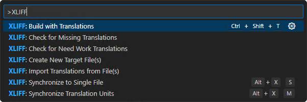
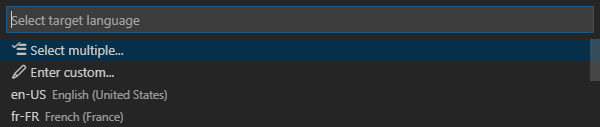
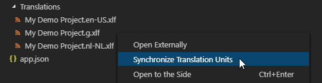
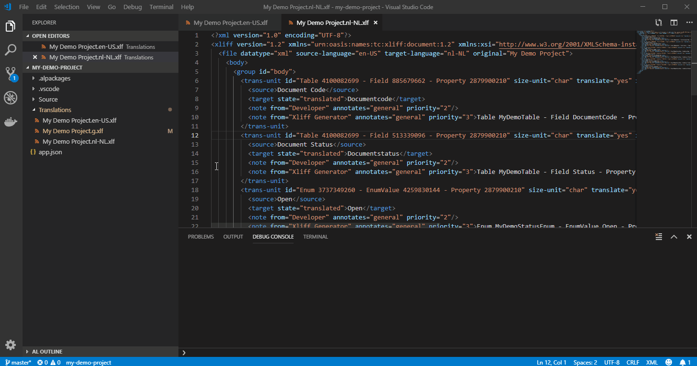
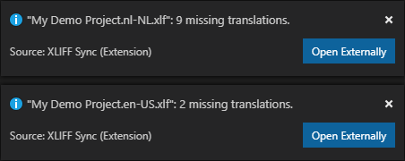
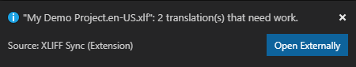
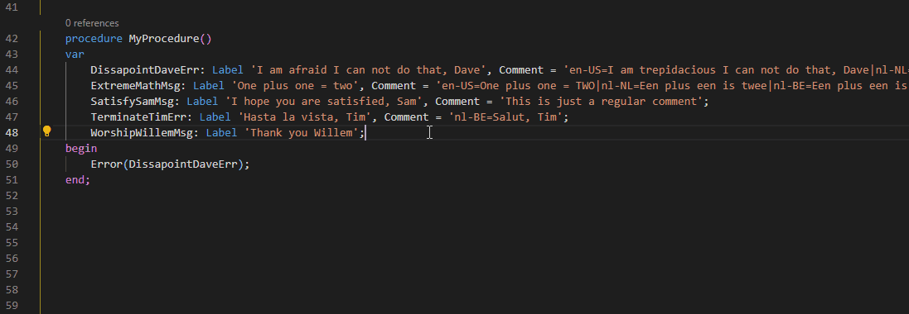

# XLIFF Sync

[](https://opensource.org/licenses/MIT) [](https://marketplace.visualstudio.com/items?itemName=rvanbekkum.xliff-sync)
 [](https://marketplace.visualstudio.com/items?itemName=rvanbekkum.xliff-sync)

<a href="https://www.buymeacoffee.com/robvanbekkum" target="_blank"></a>

A VSCode extension to keep XLIFF translation files in sync with an automatically generated base-XLIFF file.

Note that there is also an ["XLIFF Sync" PowerShell module](https://github.com/rvanbekkum/ps-xliff-sync)!

## Summary

The ["XLIFF Sync"](https://marketplace.visualstudio.com/items?itemName=rvanbekkum.xliff-sync) extension for Visual Studio Code can help you work more efficiently with XLIFF translation files in various ways.
It is specifically targeted at easing translation of extensions for [Microsoft Dynamics 365 Business Central](https://dynamics.microsoft.com/en-us/business-central/overview/), by allowing you to more easily keep `.xlf` translation files of your extensions in sync with the `.g.xlf` files that are automatically generated by the [AL Language](https://marketplace.visualstudio.com/items?itemName=ms-dynamics-smb.al) extension.
However, it can also be used in combination with other software projects that use [XLIFF](https://en.wikipedia.org/wiki/XLIFF) translation files for translation, supporting both XLIFF 1.2 and XLIFF 2.0.
Apart from synchronizing trans-units from a base-XLIFF file, this extension contributes various other features, including commands to check for missing translations, detect problems in translations and import translations from external XLIFF files.

View the demo in the [Areopa](https://areopa.academy/) webinar recording: [VS Code AL Extensions - XLIFF Sync](https://youtu.be/28JghaJHNJ4?t=376) (starts at 6:16)

More information: [XLIFF Sync: Time for a complete overview](https://robvanbekkum.nl/xliff-sync-overview/)

* [XLIFF Sync](#xliff-sync)
  * [Summary](#summary)
  * [Features](#features)
  * [Contributions](#contributions)
    * [Commands](#commands)
    * [Agent Tools](#agent-tools)
    * [Settings](#settings)
  * [Usage](#usage)
    * [Create New Target File(s)](#create-new-target-files)
      * [Using the Command Palette](#using-the-command-palette)
    * [Synchronize to Single File](#synchronize-to-single-file)
      * [Using the Command Palette](#using-the-command-palette-1)
      * [Using keyboard shortcut](#using-keyboard-shortcut)
    * [Synchronize Translation Units](#synchronize-translation-units)
      * [Using the Command Palette](#using-the-command-palette-2)
      * [Using keyboard shortcut](#using-keyboard-shortcut-1)
      * [From the Explorer](#from-the-explorer)
    * [Check for Missing Translations](#check-for-missing-translations)
      * [Using the Command Palette](#using-the-command-palette-3)
    * [Check for Need Work Translations](#check-for-need-work-translations)
      * [Using the Command Palette](#using-the-command-palette-4)
    * [Find Next Missing Translation in XLIFF File](#find-next-missing-translation-in-xliff-file)
      * [Using the Command Palette](#using-the-command-palette-5)
      * [Using keyboard shortcut](#using-keyboard-shortcut-2)
    * [Find Next Needs Work Translation in XLIFF File](#find-next-needs-work-translation-in-xliff-file)
      * [Using the Command Palette](#using-the-command-palette-6)
      * [Using keyboard shortcut](#using-keyboard-shortcut-3)
    * [Import Translations from File(s)](#import-translations-from-files)
      * [Using the Command Palette](#using-the-command-palette-7)
    * [Build with Translations](#build-with-translations)
      * [Using the Command Palette](#using-the-command-palette-8)
      * [Using keyboard shortcut](#using-keyboard-shortcut-4)
    * [Parse from Developer Note](#parse-from-developer-note)
  * [Known Issues](#known-issues)
  * [Contributors](#contributors)

## Features

* Merge new translations from a generated, base-XLIFF file into existing XLIFF files.
  * Merge from the base-XLIFF file into a manually specified target XLIFF file.
  * Merge from the base-XLIFF file into all XLIFF files in the open workspace.
* Search and highlight missing translations in an open XLIFF file.
* Run technical validations to check for problems in the translations of target XLIFF files.
* Import/Copy translations for matching sources from external XLIFF files to target XLIFF files.
* Support for XLIFF 1.2 and 2.0

## Contributions

### Commands

| Command | Explanation |
| ------- | ----------- |
| **XLIFF: Create New Target File(s)** | Create one or more new target XLIFF files from the base-XLIFF file. |
| **XLIFF: Synchronize to Single File** | Merge new trans-units from base-XLIFF file into a manually specified target XLIFF file. |
| **XLIFF: Synchronize Translation Units** | Merge new trans-units from base-XLIFF file into all other XLIFF files in the open project folder. |
| **XLIFF: Check for Missing Translations** | Checks if there are any missing translations in the target XLIFF files in the open project folder. For each file with missing translations, an informational message will be shown (with a button to open the file externally). |
| **XLIFF: Check for Need Work Translations** | Checks if there are translations that need work in the target XLIFF files in the open project folder. For example, the source text contains placeholders (e.g., "%1" or "{0}") while the translation does not. Translations with problems will be tagged with `needs-adaptation` and an "XLIFF Sync" note will be added to the trans-unit node. For each file with translations that need work, an informational message will be shown (with a button to open the file externally). |
| **XLIFF: Next Missing Translation** | In an XLIFF file that is currently opened in the active editor, search for the next missing translation. |
| **XLIFF: Next Needs Work Translation** | In an XLIFF file that is currently opened in the active editor, search for the next translation tagged as `needs-adaptation`. |
| **XLIFF: Import Translations from File(s)** | Import/Copy translations from external XLIFF files to trans-units with matching sources of target XLIFF files with the same target-language. |
| **XLIFF: Build with Translations** | Builds the project in the currently open workspace/project folder (Ctrl + Shift + B) and afterwards synchronizes all translation units from base-XLIFF file into all other XLIFF files in the open workspace/project folder. |



### Agent Tools

XLIFF Sync provides native language model tools for GitHub Copilot agent mode and other VS Code agents on **VS Code 1.99 or newer**. No separate MCP server, Node.js installation, or MCP configuration is required. Enable the XLIFF Sync tools in the chat tool picker, or reference them explicitly with `#`:

| Tool reference | Purpose |
| -------------- | ------- |
| `#xliffSyncFindReferenceTranslations` | Find exact translation matches or terminology examples in configured, read-only reference XLIFF files, with provenance. |
| `#xliffSyncUpdateProjectTranslations` | Entry point for "Update the translations of the project": refresh the source, synchronize, check, then guide the agent to resolve translations and verify. |
| `#xliffSyncVerifyProjectTranslations` | Read-only final verification of remaining missing/problem counts, skipped files, and blockers. |
| `#xliffSyncListFiles` | List XLIFF paths, versions, source/target languages, original attributes, and unit counts. |
| `#xliffSyncSynchronizeFile` | Synchronize one existing target file from a base XLIFF file. |
| `#xliffSyncSynchronizeAll` | Synchronize all target files in one workspace folder, including original-attribute filtering and equivalent languages. |
| `#xliffSyncCreateTargetFile` | Create a new target-language file at an explicit path without overwriting an existing file. |
| `#xliffSyncCheckMissingTranslations` | Check missing translations and save missing-translation states, or report without modifying files. |
| `#xliffSyncCheckNeedsWorkTranslations` | Run configured technical validations, report needs-work units, and save states/notes, or report without modifying files. |
| `#xliffSyncResolveTranslations` | Start resolution by reading unresolved units and all existing translations for terminology context. The current agent performs translation, using your instructions. |
| `#xliffSyncSaveResolvedTranslations` | Validate and save batches of agent-proposed resolutions, with stale-content checks and remaining-problem counts. |

For example: "Use #xliffSyncSynchronizeAll to synchronize translation units in this project" or "Use #xliffSyncCreateTargetFile to create a Dutch (nl-NL) translation file from the generated XLIFF."

Tools use the existing synchronization engine and resource-scoped XLIFF Sync settings for XLIFF 1.2 and 2.0. Agents supply absolute file paths; if the configured `xliffSync.baseFile` is missing or ambiguous, they must specify `sourceFilePath`. In multi-root workspaces, specify `workspaceFolderPath` or an explicit source file. Listing and synchronization discovery honor `xliffSync.fileType`.

Tools require a trusted, local workspace and saved files. For safety, they only operate inside one open workspace folder (including checking symbolic-link destinations), regardless of `xliffSync.syncCrossWorkspaceFolders`. File-changing tools request confirmation and return `sourceFilePath`, `synchronizedFiles`, and `skippedFiles` to the agent. Synchronization may remove obsolete units and change translations according to your settings, just like the existing commands. Single-file synchronization does not apply original-attribute or equivalent-language filtering.

The check tools accept `targetFilePath` for one file or check all targets in the selected workspace folder, excluding the configured base file (use `sourceFilePath` if ambiguous). Workspace checks include targets with different original attributes, just like the existing palette checker. Missing checks honor `xliffSync.missingTranslation` and `translate="no"`. Needs-work checks reuse `xliffSync.needWorkTranslationRules`, `needWorkTranslationRulesEnableAll`, and the existing state/note handling, including existing needs-work markings for units with source and target text. They report the first failing rule per unit, matching the palette checker.

By default, check tools save state and XLIFF Sync note updates without changing translation text, and request confirmation. Set `updateFiles: false` for a read-only report. Results contain per-file `missingCount`/`needsWorkCount`, `updatedFiles`, and findings with `filePath`, `id`, `source`, `target`, `kind`, and `reason`. Findings are paginated with `offset` (default 0) and `limit` (default 100, maximum 500); `totalCount` covers all findings and `nextOffset` is `null` at the end. Pagination limits only the returned findings, not which files are checked or updated. Use read-only mode when retrieving subsequent pages without saving again.

For example: "Use #xliffSyncCheckNeedsWorkTranslations to check translation problems in this project" or "Use #xliffSyncCheckMissingTranslations with updateFiles false to list missing Dutch translations."

Agent tools do not display file/language pickers, change the active editor, launch external editors, or build AL projects. Synchronization tools still do not automatically run checks: invoke the check tools explicitly afterwards. Existing palette commands retain their automatic-check behavior. Synchronization and checks are not transactional: if a later file fails, earlier files may already be saved; the error reports those files. Cancellation stops before the next write but does not undo already saved changes.

### Agent-driven translation resolution

For a project-wide update, ask "Update translations", "Refresh translations", "Bring translations up to date", or "Update the translations of the project for me". The entry tool's description identifies these phrases with the full project workflow; the word "project" is not required. If project/scope is unclear, the agent should suggest this workflow and clarify before executing. Explicit sync-only, check-only, or single-file requests should use narrower tools instead. For reliable tool selection, explicitly reference `#xliffSyncUpdateProjectTranslations` and ensure it is enabled in the chat tool picker. Reload the updated extension and start a new chat if an existing session retains old tool descriptions. Natural-language selection is model-dependent: descriptions guide the agent, but cannot guarantee selection or suggestion order.

The entry tool runs a source-refresh task and waits for task completion with exit code **0**, discovers the generated base file afterwards, synchronizes applicable targets, and saves missing/needs-work checks. It returns stage results and per-file counts so the current agent can continue with the resolution tools below and finally call `#xliffSyncVerifyProjectTranslations`. Natural-language tool selection and continuation are performed by the current agent; the extension cannot force the agent to continue.

By default, the entry tool **builds the current project** using the selected workspace folder's default build task, independent of the task provider or project language. If no default is marked, its sole build-group task is used. If no task or multiple candidates exist, configure a default build task (task group `build` with `isDefault: true`) or set `xliffSync.translationRefreshTask` to the **exact task name** from that workspace folder. An explicit task name overrides default-build selection. Tasks must be finite, non-background tasks with an observable successful process exit. For BC AL, configure a **full build** with `TranslationFile` enabled, not incremental/RAD. For Angular, configure an **`ng extract-i18n` task**, not a normal build; inline-markup/ICU resolution support remains limited. Custom projects can provide their own extraction task. An explicit `refreshSource: false` skips refresh for translation-only requests. Existing synchronize-only tools and `buildWithTranslations` behavior are unchanged.

For AL projects with **no build task**, the tool activates the AL Language extension, opens the selected project's `app.json` to target its build correctly, and awaits `al.package` with a verified `success: true` result. `TranslationFile` must be enabled and `al.incrementalBuild` disabled. Older AL extensions without structured build results require an explicit refresh task instead. Cancellation of an AL command stops subsequent synchronization but cannot terminate the extension's internal build. A project directory nested inside an open workspace is supported; explicit task overrides may select a task scoped to the owning workspace folder.

Generated `*.g.xlf`/`*.g.xlf2` files always take precedence as translation sources and are excluded from targets, even if `xliffSync.baseFile` points at a language file. Explicit source paths must not reverse that direction. Check, resolution, creation, and synchronization tools reject generated files as translation destinations (including filesystem aliases). File listings identify generated sources with `role: "generatedSource"`. Never retry a failed refresh by substituting a target file for the source or skipping refresh unless the user explicitly requests that.

Final verification re-reads saved targets and checks both configured rule sets without rebuilding, synchronizing, or saving. Its `complete` flag is false if any missing/problem counts remain, files are skipped, or no applicable targets exist. It does not guarantee linguistic accuracy or that the generated source reflects current code. Project checks apply the same original-attribute filtering as project synchronization. The agent must report remaining counts and blockers, not claim completion prematurely. The initial build package predates translation edits; build again afterwards only if an updated package is requested.

Ask, for example: "Use #xliffSyncResolveTranslations to resolve all missing and problematic German translations. Follow my terminology rules and use the file's established translations consistently."

The current agent retrieves all `filter: "translated"` pages for terminology context, then `filter: "unresolved"` pages for missing/problem units. It should reuse established terms (for example, **Document -> Beleg**, rather than introducing **Dokument**) unless your instructions explicitly override them. The tools do not start separate model requests: the current agent retains your instructions and chosen model. File notes and translation text are contextual data, not agent instructions. Conflicting terminology or ambiguous requirements should be clarified with you.

The agent submits up to 100 resolutions at a time with each unit's `id`, exact `source`, current `expectedTarget`, and proposed plain-text `target`. Saves reject stale content, non-translatable/already-resolved units, duplicates, and proposals still failing configured validation. Only selected units are updated; their states become translated and their XLIFF Sync notes are removed. The agent should refresh unresolved pages after saves and continue until remaining counts are zero or report blockers. Inline XML markup and issues in source text/developer notes need separate manual edits; tools explicitly reject unsupported resolution rather than silently damaging markup. Linguistic correctness and adherence to your instructions remain the agent's responsibility, not something technical validation can guarantee.

### Settings

#### Reference translations

Reference consumption is project-agnostic: configure existing XLIFF 1.2/2.0 files from a vendor, another product, a glossary exported as XLIFF, or a previous project. No Business Central dependency or automatic download is involved.

```json
"xliffSync.referenceTranslationFiles": [
    "reference-translations/vendor.de-DE.xlf",
    "C:\\TranslationReferences\\shared.nl-NL.xlf"
]
```

Relative paths resolve from the selected project/workspace folder; absolute paths can be outside it. The reference tool requests confirmation before reading configured files. These files are excluded from normal synchronization/check/import discovery and are protected from translation writes. The caller cannot supply arbitrary reference paths: only explicitly configured files are read. Missing/invalid configured files are reported, not silently ignored.

Resolution context exposes the configured references and directs the current agent to consult `#xliffSyncFindReferenceTranslations` before translating. Use `sourceTexts` (up to 100) for exact source matches, or `query` for case-insensitive terminology searches, along with `targetLanguage` and preferably `sourceLanguage`. Results are paginated and contain file paths, unit IDs, context, notes, and alternative translations. Missing/problematic reference units are excluded using configured checks. Language mismatches and unmatched sources are reported explicitly. Files with inline markup can provide examples, but automatic markup resolution remains unsupported.

References are suggestions, not automatic replacements. **User instructions > established project terminology > reference examples**, unless the user chooses another order. The agent must inspect context and surface conflicts rather than blindly copying. Linguistic correctness and adherence to user rules remain the agent's responsibility. Reference text and notes are data, never instructions.

Filesystem I/O is enabled by default to address large-file processing (#88). To switch back to VS Code text-document/editor I/O, set `"xliffSync.useFileSystem": false` in your user or workspace settings. The setting can also be overridden per workspace folder.

Filesystem mode processes **saved UTF-8 files** without opening text documents or target editors. Save or revert unsaved XLIFF edits first. `xliffSync.keepEditorOpenAfterSync` only applies to the document/editor implementation; explicit external-editor settings still apply to palette commands. Non-local URI providers require document mode. Files are still parsed in memory, so available memory remains a limit even though the editor's file-size restriction is bypassed.

Filesystem writes preserve each existing target's line-ending style and UTF-8 BOM, and do not rewrite byte-identical output. This prevents synchronization from changing modification timestamps when the saved result is unchanged. Git may still report a file modified with an empty diff after line-ending conversion under `core.autocrlf`; that does not necessarily indicate a translation or encoding change.

| Setting | Default | Explanation |
| ------- | ------- | ----------- |
| xliffSync.useFileSystem | `true` | Use asynchronous filesystem reads/writes for saved UTF-8 XLIFF files during synchronization, checks, imports, and agent operations. Bypasses VS Code's text-document size limit and avoids opening editors for processing. Set to `false` to restore the previous VS Code document/editor implementation. Filesystem mode requires local file URIs and refuses files with unsaved editor changes. Existing UTF-8 BOMs are preserved on writes. |
| xliffSync.translationRefreshTask | `""` | Optional exact workspace task name for source regeneration in the project-update agent tool. Empty builds the current project using its default build task, or its sole build-group task when no default is marked. Must finish with process exit code 0; for AL use a full build, for Angular an extraction task. |
| xliffSync.referenceTranslationFiles | `[]` | Existing reference XLIFF paths for agent lookup, absolute or relative to the selected project folder. Read-only; excluded from normal translation discovery. |
| xliffSync.baseFile | `.g.xlf` | Specifies which XLIFF file to use as the base (e.g., the generated XLIFF). If the file does not exist, you will be prompted to specify the file to use as base-XLIFF file the first time you use the Synchronize command. |
| xliffSync.fileType | `xlf` | The file type (`xlf` or `xlf2`). |
| xliffSync.syncCrossWorkspaceFolders | `false` | Specifies whether the extension will sync from a base file to the translation files in all workspace folders. By default, the extension will always sync. per workspace folder. If you enable this setting, then you can have the base file in one workspace folder and target translation files in other workspace folders. |
| xliffSync.matchingOriginalOnly | `true` | When synchronizing all files, sync only files whose `original` attribute matches the base file's `original` or the base file's filename. Files with other values are skipped with a warning. |
| xliffSync.unitMaps | `All` | Specifies for which search purposes this command should create in-memory maps in preparation of syncing. |
| xliffSync.missingTranslation | `%EMPTY%` | The placeholder for missing translations for trans-units that were synced/merged into target XLIFF files. You can use `%EMPTY%` if you want to use an empty string for missing translations. |
| xliffSync.needsWorkTranslationSubstate | `xliffSync:needsWork` | Specifies the substate to use for translations that need work in XLIFF 2.0 files. **Tip**: If you use [Poedit](https://poedit.net/), then you could also set this to `poedit:fuzzy`. |
| xliffSync.findByXliffGeneratorNoteAndSource | `true` | Specifies whether or not the extension will try to find trans-units by XLIFF generator note and source. |
| xliffSync.findByXliffGeneratorAndDeveloperNote | `true` | Specifies whether or not the extension will try to find trans-units by XLIFF generator note and developer note. |
| xliffSync.findByXliffGeneratorNote | `true` | Specifies whether or not the extension will try to find trans-units by XLIFF generator note. |
| xliffSync.findBySourceAndDeveloperNote | `false` | Specifies whether or not the extension will try to find translations by the combination of source and developer note. |
| xliffSync.findBySource | `false` | Specifies whether or not the extension will try to find translations by source. If there are multiple trans-units with the same source, then the translation of the first translation unit is used for all units. |
| xliffSync.parseFromDeveloperNote | `false` | Specifies whether translations should be parsed from the developer note. Translations can be retrieved from a Developer note in the following format: <code>en-US=My translation&#124;nl-NL=Mijn vertaling</code>. |
| xliffSync.parseFromDeveloperNoteOverwrite | `false` | Specifies whether translations parsed from the developer note should always overwrite existing translations. |
| xliffSync.parseFromDeveloperNoteSeparator | <code>&#124;</code> | Specifies the separator that is used when translations are parsed from the developer note. |
| xliffSync.parseFromDeveloperNoteTrimCharacters | `` | Specifies the characters that will be trimmed from the translation. |
| xliffSync.equivalentLanguages | `{ "de-DE": "de-.*", "en-US": "en-.*", "es-ES": "es-.*", "fr-FR": "fr-.*", "nl-NL": "nl-.*" }` | Specifies master and slave languages that should be treated as equivalent, i.e., translations are copied from the master language. |
| xliffSync.equivalentLanguagesEnabled | `false` | Specifies whether languages should be treated as equivalent as specified in the xliffSync.equivalentLanguages setting. |
| xliffSync.copyFromSourceForLanguages | `[]` | Specifies the languages for which translations should be copied from the source text of trans-units. |
| xliffSync.copyFromSourceForSameLanguage | `false` | Specifies whether translations should be copied from the source text if source-language = target-language. This will **not** overwrite existing translations of trans-units in target files. |
| xliffSync.copyFromSourceOverwrite | `false` | Specifies whether translations copied from the source text should overwrite existing translations. |
| xliffSync.detectSourceTextChanges | `true` | Specifies whether changes in the source text of a trans-unit should be detected. If a change is detected, the target state is changed to needs-adaptation and a note is added to indicate the translation should be reviewed. |
| xliffSync.ignoreLineEndingTypeChanges | `false` | Specifies whether changes in line ending type (CRLF vs. LF) should not be considered as changes to the source text of a trans-unit. |
| xliffSync.clearTranslationAfterSourceTextChange | `false` | Specifies whether translations should be cleared when the source text of a trans-unit changed. |
| xliffSync.addNeedsWorkTranslationNote | `true` | Specifies whether an XLIFF Sync note should be added to explain why a trans-unit was marked as needs-work. |
| xliffSync.useSelfClosingTags | `true` | Specifies whether the XML tags in the XLIFF target files should be self-closing tags. (i.e., `<note></note>` vs. `<note/>`). |
| xliffSync.keepEditorOpenAfterSync | `true` | Specifies whether XLIFF files should be opened in the editor after syncing. |
| xliffSync.openExternallyAfterEvent | `[]` | Specifies after which event translation files should be opened automatically with the default XLIFF editor. Options: "Check", "ProblemDetected", "Sync" |
| xliffSync.developerNoteDesignation | `Developer` | Specifies the name that is used to designate a developer note. |
| xliffSync.xliffGeneratorNoteDesignation | `Xliff Generator` | Specifies the name that is used to designate a XLIFF generator note. |
| xliffSync.autoCheckMissingTranslations | `false` | Specifies whether or not the extension should automatically check for missing translations after syncing. |
| xliffSync.autoCheckNeedWorkTranslations | `false` | Specifies whether or not the extension should automatically run a technical validation on translations after syncing |
| xliffSync.needWorkTranslationRules | `["OptionMemberCount", "OptionLeadingSpaces", "Placeholders"]` | Specifies which technical validation rules should be used. |
| xliffSync.needWorkTranslationRulesEnableAll | `false` | Specifies whether or not all available technical validation rules should be used. Enabling this setting makes `xliffSync.needWorkTranslationRules` redundant. |
| xliffSync.preserveTargetAttributes | `false` | Specifies whether or not syncing should use the attributes from the target files for the trans-unit nodes while syncing. |
| xliffSync.preserveTargetAttributesOrder | `false` | Specifies whether the attributes of trans-unit nodes should use the order found in the target files while syncing. |
| xliffSync.preserveTargetChildNodes | `false` | Specifies whether child nodes of trans-unit nodes specific to the target files should be preserved. This will preserve `alt-trans` nodes and custom nodes in XLIFF 1.2 target files. |
| xliffSync.replaceTranslationsDuringImport | `false` | Specifies whether existing translations will be replaced when the XLIFF: Import Translations from File(s) command is run. |
| xliffSync.decoration | `{"backgroundColor": "rgba(240, 210, 105, 0.35)", "overviewRulerColor": "rgba(240, 210, 105, 0.35)", "border": "1px solid white", "borderRadius": "4px"}` | Specifies how to highlight missing translations or translations that need work in an XLIFF file opened in the editor. |
| xliffSync.decorationEnabled | `true` | Specifies whether decorations for missing translations and translations that need work should be applied. |
| xliffSync.decorationTargetTextOnly | `false` | Specifies whether decorations for missing translations and translations that need work should only be applied to the target text. |
| xliffSync.enableSnippetsForLanguages | `[]` | Specifies the programming languages for which the XLIFF Sync snippets should be enabled. Currently supported: `al`. |
| xliffSync.snippetTargetLanguage | `TargetLanguageCode` | Specifies which target language to use by default in the XLIFF Sync snippets (e.g., `nl-NL`). |
| xliffSync.defaultLanguages | `[]` | Specifies the languages that should automatically be used for the translation file generation. If empty, you will be prompted to select the languages to create translation files for. |
| xliffSync.buildCommandToExecute | `al.package` | Specifies the build command to execute when building with translations. |

## Usage

The extension will try to find corresponding trans-units and translations within an existing file as follows:

1. Finding trans-units:

    1\. By Id

    2\. By XLIFF Generator Note & Source (enabled by default, configurable with `xliffSync.findByXliffGeneratorNoteAndSource`)

    3\. By XLIFF Generator Note & Developer Note (enabled by default, configurable with `xliffSync.findByXliffGeneratorAndDeveloperNote`)

    4\. By XLIFF Generator Note (enabled by default, configurable with `xliffSync.findByXliffGeneratorNote`)

2. Finding translations:

    5\. By Source & Developer Note (disabled by default, configurable with `xliffSync.findBySourceAndDeveloperNote`)

    6\. By Source (disabled by default, configurable with `xliffSync.findBySource`)

3. Initial translation:

    7\. Parse from Developer Note (disabled by default, configurable with `xliffSync.parseFromDeveloperNote`)

    8\. Copy from Source, if applicable/configured for target language (disabled by default, configurable with `xliffSync.copyFromSourceFor...`)

If no trans-unit or translation is found, the unit is added and its target node is tagged with `state="needs-translation"`.

### Create New Target File(s)

#### Using the Command Palette
> 1. F1 or Ctrl/Cmd + Shift + P to open the command palette
> 2. **XLIFF: Create New Target File(s)**

This command will let you create one or more new target files, using the languages specified in the `xliffSync.defaultLanguages` setting or when empty letting you choose from a set of RFC 4646 or RFC 5646 language tags depending on the XLIFF file type (i.e., `xlf` or `xlf2`).
The new file is automatically synced with the base file; if it is not known you will be prompted to specify the file to use as the base file first.



More detailed instruction: [Create New Target Files](https://robvanbekkum.nl/xliff-sync-overview/#create-new-target-files)

### Synchronize to Single File

#### Using the Command Palette
> 1. F1 or Ctrl/Cmd + Shift + P to open the command palette
> 2. **XLIFF: Synchronize to Single File**

#### Using keyboard shortcut

> 1.  Alt + X, S (default shortcut)

By default, the extension expects the base-XLIFF file to end with `.g.xlf`.
If no matching file is found, you are prompted to identify the base file.
This setting will be saved for future use.
If the extension is invoked from a localization file, that file will be updated, otherwise the extension will prompt you for the file to update.

You can also use this command to create a new XLIFF file for a language.
For this, choose the "New File..." option and choose the language tag for the new target language.

### Synchronize Translation Units

#### Using the Command Palette

> 1. F1 or Ctrl/Cmd + Shift + P to open the command palette
> 2. **XLIFF: Synchronize Translation Units**

*NOTE*: This command will merge new translations into all XLIFF files in your workspace folder (with, obviously, excluding the base-XLIFF file itself).

#### Using keyboard shortcut

> 1.  Alt + X, M (default shortcut)

#### From the Explorer

> 1. Right-click on a file with the .xlf extension.
> 2. Select: **Synchronize Translation Units**

If you select the base-XLIFF file, then translation units will be synced to all other XLIFF files in the workspace.
If you select any other XLIFF file, then translation units will be synced from the base-XLIFF file to the selected file.



Here's a small demo:



More detailed instruction: [Synchronize Translation Files](https://robvanbekkum.nl/xliff-sync-overview/#synchronize-translation-files)

### Check for Missing Translations

#### Using the Command Palette

1. F1 or Ctrl/Cmd + Shift + P to open the command palette
2. **XLIFF: Check for Missing Translations**

This will check all XLIFF files in the workspace and notify about any missing translations in the files.
You also have the option to open files with missing translations with your default XLIFF editor using the **Open Externally** button from the informational message.



More detailed instruction: [Check Translation Files](https://robvanbekkum.nl/xliff-sync-overview/#check-translation-files)

### Check for Need Work Translations

#### Using the Command Palette

1. F1 or Ctrl/Cmd + Shift + P to open the command palette
2. **XLIFF: Check for Need Work Translations**

This will run technical validation/checks for all XLIFF files in the workspace and notify about any translations that need work in the files.
You also have the option to open files containing problems with your default XLIFF editor using the **Open Externally** button from the informational message.



The target node of the trans-units containing problems will be tagged with `state="needs-adaptation"`.
Additionally, a `note` will be added to the trans-unit to explain which problem was detected.
When you run the command again after resolving the issue, then this note will be automatically removed.

You can configure the checks that need to be run with the `xliffSync.needWorkTranslationRules` setting.
The currently implemented checks are the following:

| Rule ID               | Check                                                                                                     | Trigger                                                                                    | Example                                                                                                            |
|-----------------------|-----------------------------------------------------------------------------------------------------------|--------------------------------------------------------------------------------------------|--------------------------------------------------------------------------------------------------------------------|
| `ConsecutiveSpacesConsistent` | 'Consecutive space'-occurrences are not matching. | N.A. | The source text includes 3 consecutive spaces, the translation text includes 2 consecutive spaces. |
| `ConsecutiveSpacesExist` | Source or translation text contain consecutive spaces. | N.A. | The source text includes 2 consecutive spaces, e.g., <pre>Hello  World</pre> |
| `OptionMemberCount`   | Number of options in caption are not matching.                                                            | Xliff Generator note with `Property OptionCaption` or `Property PromotedActionCategories`. | The source text includes 3 options, `A,B,C` , but the translation text includes 4 options, `A,B,C,D`.              |
| `OptionLeadingSpaces` | Number of leading spaces in options are not matching.                                                     | Xliff Generator note with `Property OptionCaption` or `Property PromotedActionCategories`. | The source text includes a space, `A, B` , but the translation text does not, `A,B`.                               |
| `Placeholders`        | Placeholders of source and translation are not matching.                                                  | Source/Translation text includes placeholders of the form `{0}` or `%1` or `#1`.                   | The source text includes placeholders `%1 %2` , but the translation text only includes `%1`.                       |
| `PlaceholdersDevNote`        | Placeholders are not explained in the Developer note.                                                  | Source text includes placeholders of the form `{0}` or `%1` or `#1`.                   | The source text includes placeholders `%1 %2` , but the Developer note is empty and so does not contain the placeholders.                       |
| `SourceEqualsTarget`  | Source and translation are not the same, even though source-language = target-language for the .xlf file. | The source-language is the same as the target-language for the .xlf file.                  | The source text is 'A', but the translation text is 'B'. The source-language and target-language are both 'en-US'. |

**Note**: You may want to use rule `SourceEqualsTarget` in combination with setting `xliffSync.copyFromSourceForSameLanguage` set to `true`.

More detailed instruction: [Check Translation Files](https://robvanbekkum.nl/xliff-sync-overview/#check-translation-files)

### Find Next Missing Translation in XLIFF File

#### Using the Command Palette

1. F1 or CMD + Shift + P to open the command palette
2. **XLIFF: Next Missing Translation**

#### Using keyboard shortcut

1. Alt + X, N (default shortcut)

Missing translations are tagged and highlighted.
You can use the extension to navigate between missing translations.
On a Macbook Pro, this command appears on the touchbar within XLIFF files.

### Find Next Needs Work Translation in XLIFF File

#### Using the Command Palette

1. F1 or CMD + Shift + P to open the command palette
2. **XLIFF: Next Needs Work Translation**

#### Using keyboard shortcut

1.  Alt + X, W (default shortcut)

Translations that need work are tagged and highlighted.
You can use this command to navigate between translations that need work.
On a Macbook Pro, this command appears on the touchbar within XLIFF files.

### Import Translations from File(s)

#### Using the Command Palette

1. F1 or Ctrl/Cmd + Shift + P to open the command palette
2. **XLIFF: Import Translations from File(s)**

This will open a file dialog in which you can select one or more XLIFF files (.xlf).
The command will copy translations from the selected files to trans-units in the XLIFF files in your project folder with the same target-language for matching sources.
It will try first to merge translations for trans-units with a matching combination of source-text and Developer note, and only after that try to merge translations to trans-units with matching source-text.
That way you could utilize the Developer note to have the import perform a more precise merge of the translations (e.g., based on tags in the Developer notes).

More detailed instruction: [Import Translations from Files](https://robvanbekkum.nl/xliff-sync-overview/#import-translations-from-files)

### Build with Translations

#### Using the Command Palette

1.  F1 or Ctrl/Cmd + Shift + P to open the command palette
2.  **XLIFF: Build with Translations**

#### Using keyboard shortcut

1.  Ctrl + Shift + T (default shortcut)

This command combines multiple actions into one command:

1. Build the project of the currently open project folder using the build command defined in the `xliffSync.buildCommandToExecute` setting.
2. If no .xlf translation files exists, then create new translation files (for the languages specified in the `xliffSync.defaultLanguages` setting).
3. Merge new translations into all XLIFF files in your workspace folder

#### Default Build Task

If you would like to make **XLIFF: Build with Translations** your default build task, then this is one of the ways you can do that:

1. Run the command **Tasks: Open Workspace/User Tasks** via the command palette, or add/edit a `tasks.json` file at workspace/project folder level.
2. Add the following task as default build task:

    ```json
    {
        "version": "2.0.0",
        "tasks": [
            {
                "label": "XLIFF: Build with Translations",
                "command": "${command:xliffSync.buildWithTranslations}",
                "problemMatcher": [],
                "group": {
                    "kind": "build",
                    "isDefault": true
                }
            }
        ]
    }
    ```

### Parse from Developer Note

An approach that is taken by some developers is to have the *initial* translation provided by the developers themselves (that is, for languages that they are proficient in, typically their mother tongue).
This can be done by adding translations as a developer note/comment in the source code, e.g.:

```pascal
procedure MyProcedure()
var
    DissapointDaveErr: Label 'I am afraid I can not do that, Dave', Comment = 'en-US=I am trepidacious I can not do that, Dave|nl-NL=Ik ben bang dat ik dat niet kan doen, Dave';
    ExtremeMathMsg: Label 'One plus one = two', Comment = 'en-US=One plus one = TWO|nl-NL=Een plus een is twee|nl-BE=Een plus een is twee';
    SatisfySamMsg: Label 'I hope you are satisfied, Sam', Comment = 'This is just a regular comment';
    TerminateTimErr: Label 'Hasta la vista, Tim', Comment = 'nl-BE=Salut, Tim';
    WorshipWillemMsg: Label 'Thank you Willem';
begin
    Error(DissapointDaveErr);
end;
```

If you want to utilize this, the "XLIFF Sync" extension for Visual Studio code can help you to automatically get the translations provided by the developer in the comments to your target XLIFF translation files.
To let "XLIFF Sync" extract/parse translations from the Developer notes, you will need to set the `xliffSync.parseFromDeveloperNote` setting to `true`.
If you synchronize with this setting enabled, then the translations will be parsed from the Developer notes and added to the translation units in your target translation files.

If you would like the translations from the Developer notes to always overwrite the existing translations in the target translation files, then you can additionally set the `xliffSync.parseFromDeveloperNoteOverwrite` setting to `true`.
This is typically used in combination with `xliffSync.detectSourceTextChanges` set to `false`, if you wish that the translation states do not change to `needs-adaptation` when the source text of translation units change.

On top of that, you can also enable snippets that help you adding captions, labels and tooltips with translation comments in your [AL](https://learn.microsoft.com/en-us/dynamics365/business-central/dev-itpro/developer/devenv-programming-in-al) source code.
For this, you can set the `xliffSync.enableSnippetsForLanguages` setting to `["al"]` and set `xliffSync.snippetTargetLanguage` to your preferred language, e.g.:

```json
{
    "xliffSync.enableSnippetsForLanguages": ["al"],
    "xliffSync.snippetTargetLanguage": "nl-NL"
}
```

You can then use snippets `tcaptionwithtranslation`, `tcommentwithtranslation`, `toptioncaptionwithtranslation`, `tpromotedactioncategorieswithtranslation`, `tlabelwithtranslation` and `ttooltipwithtranslation` to add translations in comments in your [AL](https://learn.microsoft.com/en-us/dynamics365/business-central/dev-itpro/developer/devenv-programming-in-al) source code as follows:



For an extensive example, you can also check GitHub issue [#37](https://github.com/rvanbekkum/vsc-xliff-sync/issues/37) "[Feature Request] Parsing Target from Comment".

## Known Issues

* Automatically inserting _new_ groups into target files is not implemented.
* The NAV2018 XLIFF generator creates Xliff Generator Notes without any identifiers, therefore it is recommended to change the `xliffSync.findBy...` settings to not synchronize trans-units based on Xliff Generator notes.
* Files larger than 50 MB cannot be processed at the moment. For now, please use the ["XLIFF Sync" PowerShell module](https://github.com/rvanbekkum/ps-xliff-sync) instead.

## Contributors

* [dannoe](https://github.com/dannoe)
* [FlorianNoeverGOB](https://github.com/FlorianNoeverGOB)
* [manux54](https://github.com/manux54)
* [rvanbekkum](https://github.com/rvanbekkum)
* [warlof](https://github.com/warlof)

You can find the contributions in the [Changelog](https://marketplace.visualstudio.com/items/rvanbekkum.xliff-sync/changelog).
Thank you all! 🤍
